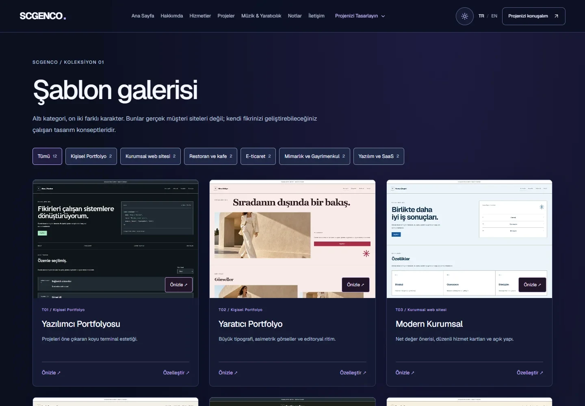
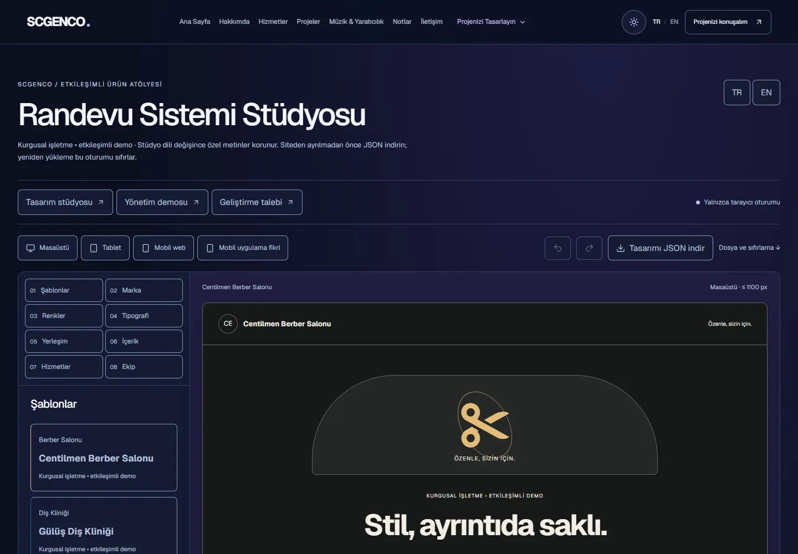
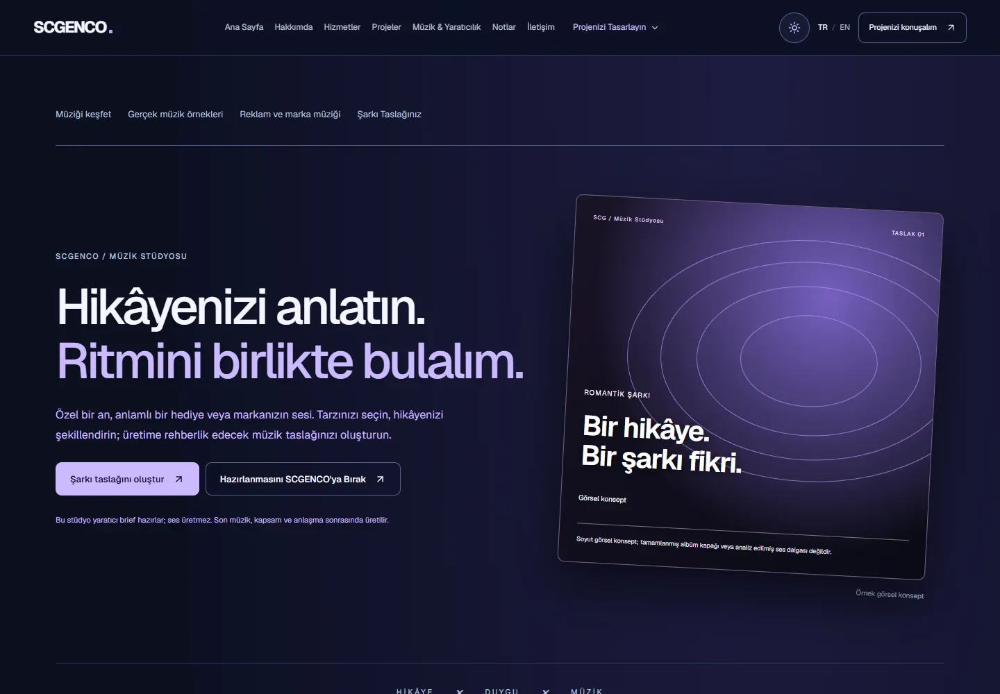

# Scgenco.com — Personal Portfolio & Digital Services Platform

[Language index](README.md) · [Türkçe](README.tr.md)

   

## Overview

Scgenco.com is Sabri Caner Genco's professional portfolio and digital services website. It combines a clear presentation of engineering work with interactive tools that help clients communicate their needs before development or creative production begins. It is intended for potential clients, collaborators, recruiters and technical reviewers.

## Key features

- Turkish and English experiences across content, studio templates, booking demos and project summaries.
- Website Studio with twelve multi-page concepts across six categories, live customization, local images and responsive previews.
- Appointment Studio with four fictional industries, service/staff customization, simulated availability, booking and management screens.
- Music Studio with twelve personal/commercial categories, musical preferences, original stories/lyrics and a customer-friendly song concept review.
- Real Estate Studio with six business profiles, six templates and 18 fictional listings across website, mobile and agency dashboard previews; filtering, galleries, favorites, comparison and an illustrative map.
- A new SG brand identity, bilingual FAQ and privacy/service information pages.
- A unified project brief that can carry an optional studio design and prepare an email draft or a downloadable file.
- Original owner-provided Turkish/English recordings with continuous playback during supported internal navigation.
- Dark/light themes, responsive layouts, accessible labels and keyboard interactions.
- Service catalog, engineering case studies, Markdown articles and direct contact paths.

## Technology stack

Next.js 16.4, React 19.3 and TypeScript 5.9; Tailwind CSS 4.3/PostCSS with custom CSS; Motion, Lucide, react-markdown and locally bundled Geist. React Context/hooks manage browser state. Node/npm/Turbopack generate static assets; TypeScript, ESLint, Node tests, Playwright and axe-core support QA. [Confirmed stack](docs/TECH_STACK.md).

## Architecture overview

The site is pre-rendered into static HTML, CSS, JavaScript and media. Interactive studios and the project brief run in the browser. Visitors explicitly choose whether to export or keep a local draft. A shared audio experience connects page surfaces. [Architecture diagrams](docs/ARCHITECTURE.md).

No production backend, database, authentication or real owner administration platform is currently implemented. The appointment dashboard is a synthetic demo. Email preparation does not automatically send a request; the music studio does not generate audio; commerce previews do not process payments.

Property, lead and viewing interactions in the real estate dashboard are fictional browser simulations. Its map is local and schematic, with no live mapping or real booking. The mobile preview is not a released Android/iOS app. Information pages do not imply completed legal review.

## Technical highlights

Stable configuration identities are separate from translated labels. Built-in demo content follows the chosen language while customized content remains original. Versioned imports are validated before replacing active work. Shared project attachments connect distinct studios to one inquiry flow. Preview styling is independent of the surrounding light/dark theme. Lazy editor loading keeps the introductory experience focused.

## Screenshots

Actual application captures, using built-in fictional sample content. No customer records, credentials, private infrastructure or production administration screens are shown.

[Capture notes](assets/screenshots/README.md).

## Development roadmap

The private application uses GitHub Actions CI and automatic Cloudflare Pages delivery after successful checks. The first pipeline deployment succeeded; production custom-domain verification remains pending. [CI/CD process and status](docs/CI_CD.md).

Planned: secure owner-only administration, inquiry/customer management, request tracking, quotation preparation and approvals, order status, transactional emails and delivery tracking, communication history and dashboard analytics. These are future capabilities, not completed features. [Roadmap and current status](docs/ROADMAP.md).

## Live website

The Cloudflare Pages pipeline has published the tested application. The intended scgenco.com production domain is not yet verified as serving that application; a live website link will be added after domain verification. Deployment configuration and credentials remain private.

## Contact and source privacy

[Email Sabri Caner Genco](mailto:s.canergenco@gmail.com) · [LinkedIn](https://www.linkedin.com/in/sabri-caner-genco-762776216/) · [GitHub](https://github.com/SCanerG)

This showcase is documentation-only. Proprietary application source, configuration, creative drafts and customer data are excluded. Copyright and brand/media rights remain with their respective owners; this repository does not grant a source-code license.
