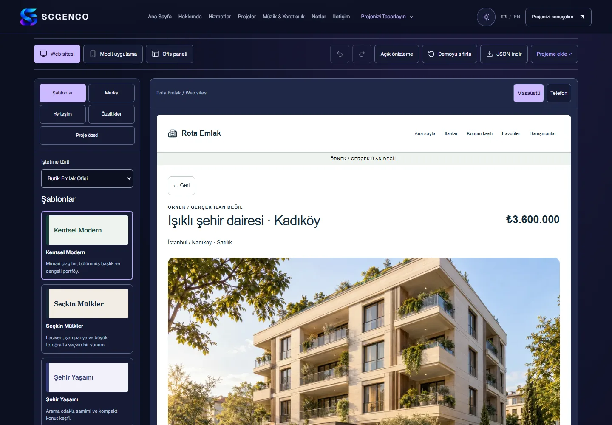

# Scgenco.com — Personal Portfolio & Digital Services Platform

   

**Sabri Caner Genco** brings software engineering, digital products and creative services together in a bilingual portfolio. Visitors can explore working studios, shape a project concept and prepare an inquiry.

**Yazılım, dijital ürünler ve yaratıcı hizmetleri bir araya getiren iki dilli portfolyo.** Ziyaretçiler çalışan stüdyoları keşfedebilir, proje fikirlerini şekillendirebilir ve talep taslağı hazırlayabilir.

## Choose your language / Dil seçin

- [English presentation](README.en.md)
- [Türkçe sunum](README.tr.md)

## Explore / İnceleyin

**October 2026 update / Ekim 2026 güncellemesi:** Four connected studios now include Real Estate Studio, alongside the new SG brand identity, bilingual FAQ and privacy/service information pages. The real estate experience uses fictional listings and browser-only simulations.

| Presentation / Sunum | Link |
| --- | --- |
| High-level architecture / Genel mimari | [Architecture](docs/ARCHITECTURE.md) |
| Confirmed technologies / Doğrulanan teknolojiler | [Technology stack](docs/TECH_STACK.md) |
| Implemented and planned / Mevcut ve planlanan | [Roadmap](docs/ROADMAP.md) |
| Private CI/CD process / Private CI/CD süreci | [Automation status](docs/CI_CD.md) |
| Actual demo screens / Gerçek demo ekranları | [Screenshots](assets/screenshots/README.md) |

**Delivery / Yayın:** The tested application was published by the private Cloudflare Pages pipeline / Test edilen uygulama private Cloudflare Pages pipeline'ı ile yayımlandı. The scgenco.com custom domain is not yet verified as serving it / scgenco.com özel alan adının bu uygulamayı sunduğu henüz doğrulanmadı. [CI/CD status / CI/CD durumu](docs/CI_CD.md).

**Contact / İletişim:** [Email](mailto:s.canergenco@gmail.com) · [LinkedIn](https://www.linkedin.com/in/sabri-caner-genco-762776216/) · [GitHub](https://github.com/SCanerG)

This repository contains presentation documentation and approved screenshots only. Application source remains private. No source-code license or rights to redistribute the brand/media are granted.

Bu depo yalnızca sunum belgeleri ve onaylı ekran görüntülerini içerir. Uygulama kaynağı özeldir. Kaynak kod lisansı veya marka/medyayı yeniden dağıtma hakkı verilmez.
