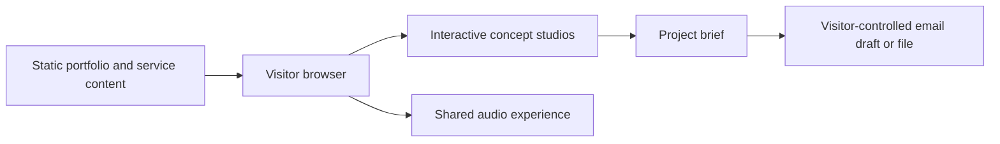
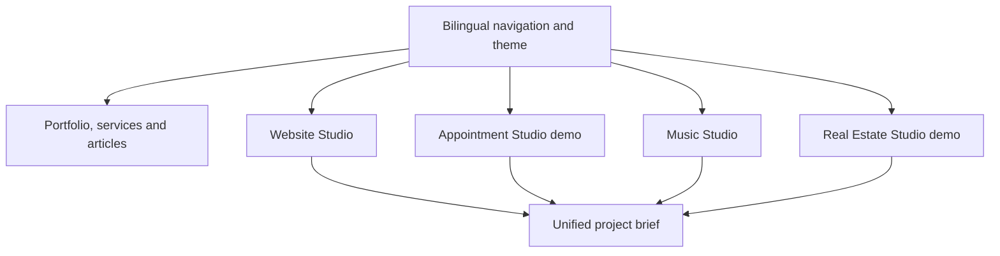
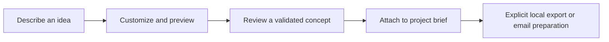
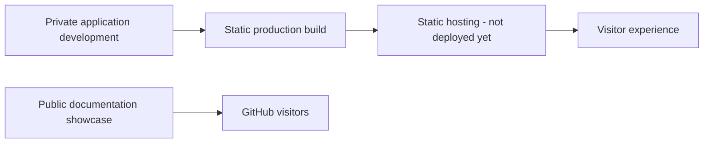

# Architecture Overview / Genel Mimari

[English](../README.en.md) · [Türkçe](../README.tr.md)

The current platform combines static content delivery with browser-based interactive concepts. No backend, database or authentication is implemented. Detailed proprietary implementation and infrastructure settings are excluded from this public document.

Mevcut platform statik içerik sunumunu tarayıcıdaki etkileşimli konseptlerle birleştirir. Backend, veritabanı ve kimlik doğrulama uygulanmamıştır. Özel uygulama ayrıntıları ve altyapı ayarları bu açık belgeye dahil edilmez.

## System / Sistem

## Experience components / Deneyim bileşenleri

## User data flow / Kullanıcı veri akışı

Real Estate Studio shares one fictional portfolio across website, mobile and agency dashboard previews. It supports local customization, validated concept files and a project brief. The illustrative map, leads and viewings do not connect to live providers or customer systems.

Emlak Stüdyosu web, mobil ve ofis panelinde aynı kurgusal portföyü kullanır. Yerel özelleştirme, doğrulanan konsept dosyaları ve proje özeti desteklenir. Temsili harita, adaylar ve gezdirmeler canlı sağlayıcı veya müşteri sistemine bağlanmaz.

## Delivery / Sunum ve dağıtım

Custom text stays original when interface language changes. Local saves and file exports require explicit visitor actions. Demo booking records are fictional; email drafts are not sent automatically. A future authenticated owner platform is separately [planned](ROADMAP.md), not part of the current diagrams.

Arayüz dili değişince özel metinler özgün kalır. Yerel kayıt ve dışa aktarım açık eyleme bağlıdır. Demo randevular kurgusaldır; e-posta taslakları otomatik gönderilmez. Kimliği doğrulanan sahip platformu ayrıca [planlanmaktadır](ROADMAP.md); mevcut diyagramların parçası değildir.
